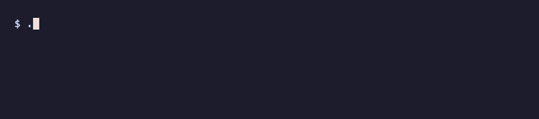

# Thymus

A normal day:



After installing a package that plants Mini Shai-Hulud persistence:


Learns what "self" looks like on your Mac (every place code can quietly get itself run) and tells you only what is new since then.

The thymus is the organ that teaches the immune system to tell self from non-self. 2025-2026 npm worms (Shai-Hulud and successors) persist through Claude Code hooks, VS Code tasks, MCP configs, git hooks and LaunchAgents, and `npm uninstall` removes none of it. Thymus does not know what malware looks like. It knows what your machine looked like yesterday.

## 30-second quickstart

Needs Node 23.6+ (runs TypeScript directly), no dependencies.

```sh
git clone <this repo> thymus && cd thymus
./bin/thymus             # first run: learns your Mac into ~/.thymus/self.json and prints a short summary
./bin/thymus             # every later run: what is new or changed? exit 1 if anything
./bin/thymus explain launchagents:user/com.example.agent   # what is this, what runs it, who signed it
./bin/thymus approve launchagents:user/com.example.agent   # or --all
./bin/thymus check       # look up your packages in osv.dev for known malicious versions (network, see below)
```

Other commands: `thymus init` / `thymus diff` (the same two steps by name), `thymus list [--suspicious]` (the baseline), `thymus receptors` (receptors, item counts, errors), `--json` on `diff` and `check`. Daily run with a notification: `thymus schedule install` ([docs/launchd.md](docs/launchd.md)).

## Sample output

```
$ thymus
KNOWN-BAD: 1 item(s) match a published attack indicator
  ! projects:~/Work/acme/web/.vscode/setup.mjs  shai-hulud */.vscode/setup.mjs
      Mini Shai-Hulud / ChainDrop loader planted in repos
      https://www.csa.gov.sg/alerts-and-advisories/advisories/ad-2026-009

thymus: 3 new, 1 changed, 0 removed since 2026-10-20 10:00

launchagents
  + /Users/me/.local/share/.u/node /Users/me/.local/share/.u/index.js [SUSPICIOUS: ad-hoc signed]
      runs at every login
      launchagents:user/com.example.helper
      look: plutil -p ~/Library/LaunchAgents/com.example.helper.plist

projects
  + SessionStart hook: node .vscode/setup.mjs
      runs at every Claude session start
      projects:~/Work/acme/web/.claude/settings.json:hook/SessionStart/*/node .vscode/setup.mjs
      look: cat ~/Work/acme/web/.claude/settings.json
  + script in .vscode/: setup.mjs
      runs when you work in this repo
      projects:~/Work/acme/web/.vscode/setup.mjs
      look: cat ~/Work/acme/web/.vscode/setup.mjs

shellrc
  ~ shellrc:~/.zshrc
      runs every time you open a terminal
      look: cat ~/.zshrc

Known and wanted?  thymus approve <receptor:id> ...   (or --all)
Not sure?  run the look: command, see where it came from (ls -l@ <path>, git log -- <file>), search the label.
Thymus never deletes anything: remove it by hand, then approve the removal.
```

`+` new, `~` changed (content hash differs), `-` removed. Removed items are shown but do not make the exit code 1. Colors only when stdout is a terminal (`NO_COLOR` turns them off).

The GIFs come from `source demo/demo.sh`, then `thymus`, `npm install @demo/colors` (a fake npm), `thymus`: a throwaway fake HOME, a baseline, then a simulated infection with the published Mini Shai-Hulud file layout and inert payloads. Run them yourself, or re-record with `vhs demo/clean.tape` and `vhs demo/infected.tape`. Add `-v` to any thymus command for the detailed view.

If it is Shai-Hulud: unload its LaunchAgent first (`launchctl bootout gui/$(id -u)/com.user.gh-token-monitor`), only then revoke GitHub and npm tokens. Its handler is reported to run `rm -rf ~/` when the token stops working ([Wiz](https://www.wiz.io/blog/mini-shai-hulud-strikes-again-tanstack-more-npm-packages-compromised), [JFrog](https://research.jfrog.com/post/shai-hulud-here-we-go-again/), [Intrudify](https://github.com/Intrudify/mini-shai-hulud-scanner)).

## Who signed it

For every item that runs a program (LaunchAgents and Daemons, MCP servers, Dock and re-opened apps, plugin bundles) Thymus reads the code signature with `codesign -dv --verbose=2` and shows it next to the item:

| Shown as | Meaning | Marked |
|---|---|---|
| `(Apple)` | part of macOS | line dimmed |
| `(Developer ID BJ4HAAB9B3)`, `(App Store ...)` | signed by the vendor with that Apple Team ID | |
| `[SUSPICIOUS: unsigned]`, `[SUSPICIOUS: ad-hoc signed]` | nobody vouches for this binary | red |
| `[SUSPICIOUS: binary missing]` | the job points at a file that is not there (stale, or waiting for a payload) | red |
| `[SUSPICIOUS: script in a writable folder]` | `node`, `python`, `bash`, `osascript`... running a file in your home or a temp dir, which anything you run can rewrite | red |
| `(downloads a package at run time)` | `npx`, `uvx`, `bunx`: the code is fetched from a registry when it starts | |

Verdicts are cached by path and modification time in `~/.thymus/codesign-cache.json`, so a warm run stays fast. The signature is not part of the item hash, so it never causes a "changed" by itself. Thymus does not run `spctl --assess`: it can wait about 15 s on a network notarization check. Homebrew binaries are ad-hoc signed on Apple Silicon, so their agents show as suspicious unless a card trusts them (the default `homebrew.mxcl.*` card does).

## Known-bad (antibodies)

`antibodies/*.json` are indicator packs: file names, SHA-256 hashes and launchd labels copied from published advisories, each with its source URL. Every run (`thymus`, `diff`, `check`) matches them against everything the receptors see, baselined or not, and prints `KNOWN-BAD` at the top with exit code 1. The shipped pack covers the Shai-Hulud family (2025 waves, Mini Shai-Hulud, the keyv / ChainDrop wave from [CSA Singapore AD-2026-009](https://www.csa.gov.sg/alerts-and-advisories/advisories/ad-2026-009)). Packs are plugins: drop your own JSON in `~/.thymus/antibodies/`.

```json
{
  "name": "my-pack",
  "advice": "printed once when anything in this pack matches",
  "iocs": [
    { "file": "setup_bun.js", "note": "what it is", "url": "https://source" },
    { "file": "*/.github/workflows/formatter_*.yml", "url": "..." },
    { "sha256": "64 hex chars", "url": "..." },
    { "label": "*gh-token-monitor*", "url": "..." }
  ]
}
```

`file` is a glob on the file name, or on the full path when it contains a `/`. It is matched against each item's file and the program or script it runs. `sha256` is compared with the content of those files. `label` is a glob on `receptor:id` and the label. Globs are case-insensitive with `*` only.

## thymus check: malicious package versions

`thymus check` collects name and version from the lockfiles in your repos (`package-lock.json`, `npm-shrinkwrap.json`, `pnpm-lock.yaml`, `yarn.lock`, `bun.lock`, `poetry.lock`, `uv.lock`, `requirements.txt`) and from `npm ls -g`, and looks them up in [osv.dev](https://osv.dev) with one `querybatch` call per 1000 packages. Only `MAL-` advisories count ([OpenSSF malicious packages](https://github.com/ossf/malicious-packages)), ordinary CVEs are ignored. It also sweeps repo folders, `.github/workflows` and the top of every installed package for IOC file names such as `bun_environment.js`. Exit code 1 on any hit, each one with package, version, lockfile and the osv.dev link.

This sends package names and versions to osv.dev (Google), which is why it is a separate command and never part of `diff`. Keep internal packages out with `~/.thymus/config.json`: `{"private": ["@mycorp/*", "internal-*"]}`. `--no-global` skips `npm ls -g`. Answers are cached for a day in `~/.thymus/osv-cache.json`.

## Read-only by design

Thymus writes only inside `~/.thymus` (or `$THYMUS_HOME`): the baseline, `known.json` and two caches. It never deletes, unloads or edits anything it finds. Snapshots store hashes and short labels, never file contents: secret-looking values (npm tokens, MCP `env`, `token=...`) are hashed or masked.

## Receptors

A receptor is one executable file that prints a JSON array to stdout:

```json
[{ "id": "unique-within-receptor", "label": "what a human should see", "path": "/optional/file", "hash": "anything that changes when the thing changes" }]
```

Built-in receptors live in `receptors/`, yours go in `~/.thymus/receptors/` (same name overrides a built-in). Any language works as long as the file is executable. A `.ts` file that does `export default async () => items` works too. A receptor that crashes, times out (30 s) or prints bad JSON is reported as an error and the rest of the run goes on.

A complete receptor in bash, tracking files in `~/bin`:

```bash
#!/bin/bash
# ~/.thymus/receptors/home-bin.sh: every executable in ~/bin, hashed.
items=""
for p in "$HOME"/bin/*; do
  [ -f "$p" ] && [ -x "$p" ] || continue
  hash=$(shasum -a 256 < "$p" | cut -c1-64)
  name=$(basename "$p")
  items="$items${items:+,}{\"id\":\"$name\",\"label\":\"~/bin/$name\",\"path\":\"$p\",\"hash\":\"$hash\"}"
done
echo "[$items]"
```

`chmod +x` it, then `thymus diff` shows its items as new; `thymus approve --all` adopts them. Receptors read `$HOME`, so tests can point them at a fake home.

## Self-antigen cards

`~/.thymus/known.json` pre-approves common legit items so they never show up. Each card is a set of case-insensitive globs (`*` only) and all given fields must match:

```json
[{ "receptor": "launchagents", "id": "*/com.docker.*", "label": "*docker*" }]
```

Pin the `label` (what the job runs) whenever you can: an id alone is easy to imitate. A card can also trust a code-signing vendor by Apple Team ID, for any item whose program that vendor signed:

```json
[{ "team": "BJ4HAAB9B3" }, { "receptor": "launchagents", "team": "EQHXZ8M8AV" }]
```

Find a Team ID with `codesign -dv --verbose=2 /Applications/zoom.us.app 2>&1 | grep TeamIdentifier`, or `thymus explain <id>`. `thymus init` copies a small default list from `known.default.json`, including Team IDs of Microsoft, Google, Docker, Tailscale, Objective-See, 1Password and Slack. Each of those has a `source` link to the vendor's own docs or code where the ID appears; vendors whose ID could not be confirmed that way (Zoom, Anthropic, Cursor among them) are left out, add them yourself if you use them.

## Surfaces

| Receptor | What it watches |
|---|---|
| launchagents | `~/Library/LaunchAgents`, `/Library/LaunchAgents`, `/Library/LaunchDaemons` (plist hash, label = program) |
| crontab | each active line of `crontab -l` |
| shellrc | zsh, bash, fish startup files in `$HOME` and `/etc` |
| ssh | `authorized_keys` (one item per key fingerprint), `~/.ssh/rc`, `~/.ssh/config` `ProxyCommand`, `LocalCommand`, `KnownHostsCommand`, `Match exec`, `Include` |
| browsers | Chrome, Brave, Arc, Edge, Chromium, Vivaldi extensions per profile |
| git | global git hooks (`core.hooksPath`, template dirs) and git config keys that run commands |
| editors | VS Code, Insiders, Cursor, Windsurf extensions and user-level `tasks.json` |
| claude | Claude Code user hooks, statusLine, credential helpers, enabled plugins |
| mcp | MCP servers in Claude Code, Claude Desktop, Cursor, Windsurf, VS Code, Gemini CLI |
| codex | Codex `config.toml` MCP servers and `notify` |
| npmrc | `~/.npmrc` keys (secret values hidden) |
| hammerspoon | `~/.hammerspoon` Lua files, Spoons, a moved config (`MJConfigFile`) |
| menubar | xbar, BitBar and SwiftBar plugin scripts (dirs read from each app's preferences) |
| terminal | Terminal.app profile `CommandString` / `Shell`, iTerm2 profile commands and AutoLaunch scripts, Ghostty `command` / `initial-command` |
| apps | Dock pinned apps and apps re-opened at login (signing checked) |
| plugins | preference panes, screen savers, color pickers, QuickLook and Spotlight plugins (user and `/Library`), folder action scripts |
| legacy | your `at` jobs, periodic scripts, emond rules, StartupItems, only where present |
| projects | inside your repos: `.claude/settings*.json` hooks, `.vscode/tasks.json` folderOpen tasks, scripts dropped in `.claude/` or `.vscode/`, `.mcp.json` and other project MCP configs, `.cursor/hooks.json`, exec-capable `.vscode/settings.json` keys, `.git/hooks` |

The projects receptor walks `~/Work`, `~/Projects`, `~/code`, `~/src`, `~/dev`, `~/Developer`, `~/repos`, `~/git`, `~/GitHub` (whichever exist, 5 levels deep, skipping `node_modules`, `vendor`, build dirs). It never touches `~/Documents`, `~/Desktop`, `~/Downloads` or `~/Library` unless you ask, since macOS would show a privacy prompt. Your own roots: `~/.thymus/config.json` with `{"roots": ["~/Documents/code"]}`.

Full list of known persistence surfaces with sources, including what is not covered yet: [docs/surfaces.md](docs/surfaces.md).

## Tests

```sh
npm test   # node --test with a fake HOME per test
```
